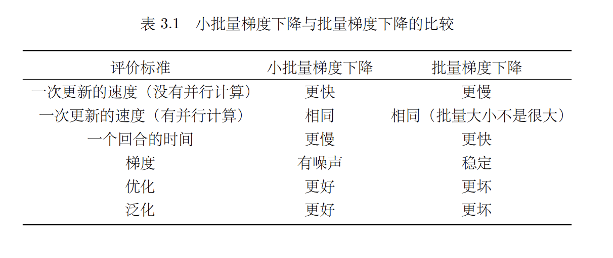
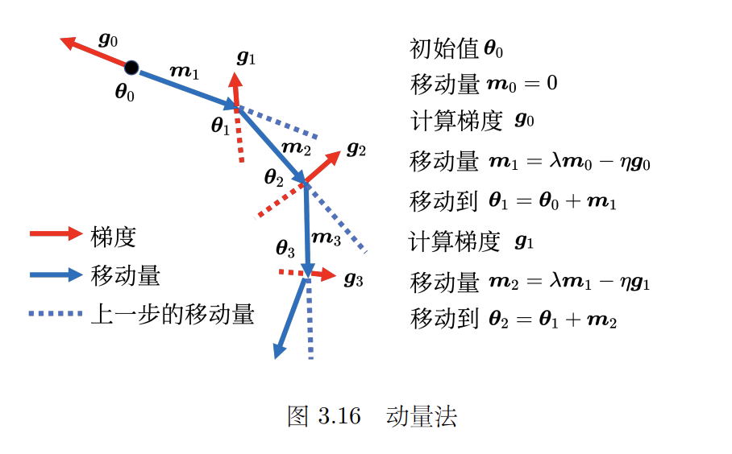
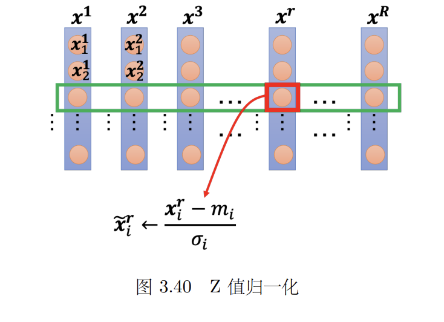

# 第 3 章：深度学习基础

[学习笔记目录](README.md) · [上一章](Chap2%20%E5%AE%9E%E8%B7%B5%E6%96%B9%E6%B3%95%E8%AE%BA.md) · [下一章](Chap4%20%E5%8D%B7%E7%A7%AF%E7%A5%9E%E7%BB%8F%E7%BD%91%E7%BB%9C.md)

---

这里介绍深度学习常见的概念，帮助我们从不同的角度来更好地优化神经网络。

  首先要理解为什么优化会失败：收敛在局部最小值和鞍点会导致优化失败。
  其次是对学习率进行调整，使用自适应学习率和学习率调度。
  最后，批量归一化可以改变误差表面，对优化也有帮助。

## 3.1 局部极小值和鞍点

深层网络没有发挥出完整的力量，说明优化是有问题的。但有时候，模型一开始就训练不起来，不管我们怎么更新参数，损失都降不下去。这个时候到底发生了什么事情？

### 3.1.1 临界点及其种类

当损失关于参数的微分为0的时候，梯度下降就不能再更新了，训练中断，损失不再下降。
梯度为0，最先想到是**局部极小值**，其实还有**鞍点**。

我们把梯度为0的点统称为**临界点(critical point)**。
如何判断临界值的种类？

### 3.1.2 判断临界值种类的方法

我们需要知道损失函数的形状。但对于复杂网络，这很困难，我们有如下的方法。

给定一组参数 $`\boldsymbol{\theta'}`$ ，在其附近的损失函数能近似为（采用泰勒级数近似）

```math
L(\boldsymbol\theta)\approx L(\boldsymbol\theta')+(\boldsymbol\theta-\boldsymbol\theta')^\top\boldsymbol{g}+\frac{1}{2}(\boldsymbol\theta-\boldsymbol\theta')^\top\boldsymbol H(\boldsymbol\theta-\boldsymbol\theta')
```

这里，第一项 $`L(\boldsymbol\theta')`$ 告诉我们，当 $`\boldsymbol{\theta}`$ 和 $`\boldsymbol\theta'`$ 很接近的时候，$`L(\boldsymbol\theta)`$和$`L(\boldsymbol\theta')`$ 应该也很接近；

第二项，$`\boldsymbol{g}`$ 代表梯度，有时候写成$`\nabla L(\boldsymbol{\theta'})`$，即

```math
g_i=\frac{\partial L(\boldsymbol\theta')}{\partial\theta_i}
```

还需要第三项，$`\frac{1}{2}(\boldsymbol\theta-\boldsymbol\theta')^\top\boldsymbol H(\boldsymbol\theta-\boldsymbol\theta')`$ ,这个和**海森矩阵$`\boldsymbol H`$** 有关系。

```math
H_{ij}=\frac{\partial^2}{\partial \theta_i\partial \theta_j}L(\boldsymbol\theta')
```

对于临界点来说，梯度$`\boldsymbol{g}`$ 自然为0，损失函数可以近似为

```math
L(\boldsymbol\theta)\approx L(\boldsymbol\theta')+\frac{1}{2}(\boldsymbol\theta-\boldsymbol\theta')^\top\boldsymbol H(\boldsymbol\theta-\boldsymbol\theta')
```

现在可以根据$`\frac{1}{2}(\boldsymbol\theta-\boldsymbol\theta')^\top\boldsymbol H(\boldsymbol\theta-\boldsymbol\theta')`$来判断**误差表面**长什么样子，然后就可以判断是临界点的种类了。

用 $`\boldsymbol{v}`$ 表示 $`\boldsymbol\theta-\boldsymbol\theta'`$，$`(\boldsymbol\theta-\boldsymbol\theta')^\top\boldsymbol H(\boldsymbol\theta-\boldsymbol\theta')`$ 改写成 $`\boldsymbol v^\top\boldsymbol H\boldsymbol v`$

分为以下三种情况：

  (1) 如果对所有 $`\boldsymbol{v}`$，$`\boldsymbol{v}^{\mathrm{T}} \boldsymbol{H} \boldsymbol{v} > 0`$。这意味着对任意 $`\boldsymbol{\theta}`$，$`L(\boldsymbol{\theta}) > L(\boldsymbol{\theta}')`$。这代表 $`L(\boldsymbol{\theta}')`$ 是附近的一个最低点，所以它是局部极小值。

  (2) 如果对所有 $`\boldsymbol{v}`$，$`\boldsymbol{v}^{\mathrm{T}} \boldsymbol{H} \boldsymbol{v} < 0`$。这意味着对任意 $`\boldsymbol{\theta}`$，$`L(\boldsymbol{\theta}) < L(\boldsymbol{\theta}')`$，$`\boldsymbol{\theta}'`$ 是附近最高的一个点，$`L(\boldsymbol{\theta}')`$ 是局部极大值。

  (3) 如果对于 $`\boldsymbol{v}`$，$`\boldsymbol{v}^{\mathrm{T}} \boldsymbol{H} \boldsymbol{v}`$ 有时候大于零，有时候小于零。这意味着在 $`\boldsymbol{\theta}'`$ 附近，有时候 $`L(\boldsymbol{\theta}) > L(\boldsymbol{\theta}')`$，有时候 $`L(\boldsymbol{\theta}) < L(\boldsymbol{\theta}')`$。因此在 $`\boldsymbol{\theta}'`$ 附近，$`L(\boldsymbol{\theta}')`$ 既不是局部极大值，也不是局部极小值，而是鞍点。

还有一个更加简单的办法，只要看 $`\boldsymbol H`$ 的特征值。

  若 $`\boldsymbol H`$ 的特征值都是正的， $`\boldsymbol H`$ 是正定矩阵，那么$`\boldsymbol{v}^{\mathrm{T}} \boldsymbol{H} \boldsymbol{v} > 0`$，临界点是局部最小值

  若 $`\boldsymbol H`$ 的特征值都是负的， $`\boldsymbol H`$ 是负定矩阵，那么$`\boldsymbol{v}^{\mathrm{T}} \boldsymbol{H} \boldsymbol{v} < 0`$，临界点是局部最大值

  若 $`\boldsymbol H`$ 的特征值有正有负，临界点是鞍点。

当我计算得到是鞍点的时候呢，我们可以根据计算结果来更新参数。
  顺着**负特征值**的特征相连的光方向去更新参数即可。这样就可以逃离鞍点，减小损失。因为在**这个方向上**，鞍点是**局部极大值**。如果沿着这个特征向量离开鞍点，损失值就会下降。

但是实际上，计算海森矩阵的运算量非常大，还要计算特征值和特征向量，用这个方法逃离鞍点，难于上青天。我们有一些别的方法来替代。

  先问一个问题：鞍点和局部极小值谁更加常见？如果我们经常遇到的是鞍点，比较少遇到局部极小值，那就很好。

让我们降维打击！在更高维的空间中，是否有路可走？
  我们在训练一个网络的时候，参数数量动辄达百万千万级，所以误差表面其实有非常高的维度—— 参数的数量代表了误差表面的维度。既然维度这么高，会不会其实就有非常多的路可以走呢？既然有非常多的路可以走，会不会其实局部极小值就很少呢?

根据一些实验，我们确实能发现这样的结果！
从经验上看起来，局部极小值并没有那么常见。多数的时候，我们训练到一个梯度 很小的地方，参数不再更新，往往只是遇到了鞍点。

## 3.2 批量和动量

实际上在计算梯度的时候，并不是对所有数据的损失 $`L`$ 计算梯度，而是把所有的数据分成一个一个的批量(batch)。在这个过程中，我们还会随机打乱。
即在每一个回合开始之前重新划分批量，也即，每个回合的批量的数据都不一样。

### 3.2.1 批量大小对梯度下降法的影响

+ **批量梯度下降法(BGD)** 使用全批量的数据来更新参数
+ **随机梯度下降法(SGD)** 批量较小，更新参数和计算损失的次数更多
  随机梯度下降的梯度上引入了随机噪声，因此在非凸优化问题中，其相比批量梯度下降更容易逃离局部最小值。



### 3.2.2 动量法

动量法(momentum method)是另外一个对抗鞍点或者局部最小值点的方法。
考虑一个物理图像：当小球动量较大的时候（比如从高处滚下），那就可以翻越过小坡，而不一定会被鞍点或者局部最小值点卡住，我们将其应用到梯度下降中。

具体而言
  引入动量后，每次在移动参数的时候，不是只往梯度的反方向来移动参数，而是根据梯度的**反方向**加上**前一步移动的方向**决定移动方向。

每一步的移动都用 $`\boldsymbol{m}`$ 来表示， $`\boldsymbol{m}`$ 可以写成之前所有计算的梯度的加权和。

```math
\begin{aligned}&\boldsymbol m_0=0\\&\boldsymbol m_1=-\eta\boldsymbol g_0\\&\boldsymbol m_2=-\lambda\eta\boldsymbol g_0-\eta\boldsymbol g_1\\&...\end{aligned}
```

其中 $`\eta`$  是学习率，$`\lambda`$ 是前一个方向的权重参数，也是需要调的。

如何理解动量法？2种角度：

1. 动量是梯度的反方向加上前一次移动的方向
2. 加上动量的时候，更新的方向不只是考虑现在梯度，而是考虑过去所有的梯度的总和（相当于惯性的积累）。



## 3.3 自适应学习率

临界点其实不一定是在训练一个网络的时候会遇到的最大的障碍。
  有时候，随着迭代次数增多，虽然损失不再下降，但是梯度的范数（梯度向量的长度）并没有真的变得很小。
  有时候，梯度在山谷的两个谷壁间，不断地来回“震荡”，这是，损失不会再下降。

实际训练一个网络的时候，要走到鞍点或局部最小值，是一件困难的事情。
  过于大的学习率出现很大的“震荡”，过于小的学习率会永远走不到终点。

因此，对于所有的参数，设置同样的学习率显然是不够的，应该要为每一个参数定义学习率，我们引入**自适应学习率**的方法。
  如果在某一个方向上，梯度的值很小，非常平坦，我们会希望学习率调大一点；如果在某一个方向上非常陡峭，坡度很大，我们会希望学习率可以设得小一点。

### 3.3.1 AdaGrad

**AdaGrad** 是典型的自适应学习率的方法，能根据梯度大小自动调整学习率。
梯度下降更新参数:

```math
\boldsymbol{\theta_t^i}-\eta\boldsymbol g_t^i\rightarrow\boldsymbol{\theta_{t+1}^i}\quad where\quad \boldsymbol g_t^i=\left.\frac{\partial L}{\partial \boldsymbol{\theta^i}}\right|_{\boldsymbol{\theta_t^i}=\boldsymbol{\theta_t}}
```

现在要有一个随着参数变化的学习率，即

```math
\boldsymbol{\theta_t^i}-\frac{\eta}{\sigma_t^i}\boldsymbol g_t^i\rightarrow\boldsymbol{\theta_{t+1}^i}
```

$`\sigma_t^i`$的上标表示和参数有关，下标表示和迭代次数有关，此时的学习率$`\frac{\eta}{\sigma_t^i}`$ 变成了**参数相关**
参数相关的常见类型是算梯度的均方根。

具体的计算过程是:
  第$`t+1`$ 次更新参数的时候，

  ```math
  \boldsymbol{\theta_t^i}-\frac{\eta}{\sigma_t^i}\boldsymbol g_t^i\rightarrow\boldsymbol{\theta_{t+1}^i}\quad where\quad \sigma^i_t=\sqrt{\frac{1}{t+1}\sum_{j=0}^t(\boldsymbol g_j^i)^2}
  ```

我们来看看这个式子的意思
  当梯度计算出来比较大的时候，$`\sigma^i_t`$ 就比较大，相应的学习率$`\frac{\eta}{\sigma_t^i}`$就会比较小，步伐就比较小，参数更新的就慢。

  反之，当梯度计算出来比较小的时候，$`\sigma^i_t`$ 就比较小，相应的学习率$`\frac{\eta}{\sigma_t^i}`$就会比较大，步伐就比较大，参数更新的就快。
由此就完成了自动调整学习率的步骤。

### 3.3.2 RMSProp

同一个参数需要的学习率，也会随着时间而改变。
同一个参数的同个方向，在不同的位置，由于梯度不同，也会需要不同的学习率，于是就有了新的方法----**RMSprop（Root Mean Squared propagation）**

RMSprop 的Step1 和Aagrad 一样，即

```math
\sigma_0^i=\sqrt{(g^i_0)^2}=|\boldsymbol g_0^i|
```

Step2为

```math
\boldsymbol{\theta}_2^i \leftarrow \boldsymbol{\theta}_1^i - \frac{\eta}{\sigma_1^i} \boldsymbol{g}_1^i \quad \sigma_1^i = \sqrt{\alpha (\sigma_0^i)^2 + (1 - \alpha) (\boldsymbol{g}_1^i)^2}
```

其中 $`0 < \alpha < 1`$，是一个可以调节的超参数。
这里Step2就能看出，现在可以自己调整这个梯度的重要性。$`\alpha`$ 越大，表示$`(\boldsymbol{g}_1^i)^2`$越不重要，之前算出的梯度更加重要。

反复这样的过程

```math
\boldsymbol{\theta}_3^i \leftarrow \boldsymbol{\theta}_2^i - \frac{\eta}{\sigma_2^i} \boldsymbol{g}_2^i \quad \sigma_2^i = \sqrt{\alpha (\sigma_1^i)^2 + (1 - \alpha) (\boldsymbol{g}_2^i)^2}\\\vdots\\\boldsymbol{\theta}_{t+1}^i \leftarrow \boldsymbol{\theta}_t^i - \frac{\eta}{\sigma_t^i} \boldsymbol{g}_t^i \quad \sigma_t^i = \sqrt{\alpha (\sigma_{t-1}^i)^2 + (1 - \alpha) (\boldsymbol{g}_t^i)^2}
```

RMSprop可以通过 $`\alpha`$ 决定$`\boldsymbol g_t^i`$ 相较于之前存在于 $`\sigma_{t-1}^i`$ 里面的 $`\boldsymbol g_1^i,\boldsymbol g_2^i,...,\boldsymbol g_{t-1}^i`$的重要性有多大。即如果 $`\boldsymbol g_t^i`$ 比较大，就会让 $`\alpha`$ 变小一点，让 $`\sigma_{t}^i`$ 变大，从而减小步伐。

### 3.3.3 Adam

最常用的优化的策略或者**优化器(optimizer)** 是 **Adam(Adaptive moment estimation)**
Adam可以看成是RMSprop加上动量，使用动量作为参数更新方向，并且能够自适应调整学习率。

PyTorch 里面已经写好了 Adam 优化器，这个优化器里面有一些超参数需要人为决定，但是往往用 PyTorch 预设的参数就足够好了。

## 3.4 学习率调度

AdaGrad 的问题在于，在平坦区域因为历史梯度很小，导致累积的均方根 $`\sigma_t^i`$ 很小，使得步幅变得很大，从而在快到终点时突然“爆炸”。
通过**学习率调度（learning rate scheduling）** 可以解决这个问题

之前的学习率调整中 $`\eta`$ 是一个定值，在学习率调度中，$`\eta`$ 和时间有关，

```math
\boldsymbol{\theta_t^i}-\frac{\eta_t}{\sigma_t^i}\boldsymbol g_t^i\rightarrow\boldsymbol{\theta_{t+1}^i}
```

最常见的策略是**学习率衰减**，也称为**学习率退火**，随着参数的不断更新，让 $`\eta`$ 越来越小，这样就可以很顺利地走到终点。

除此之外，还有一个经典的学习率调度的方式---**预热**。
  预热的方法是让学习率先变大后变小，至于变到多大，变大的速率，变小的速率，都是超参数。

在残差网络中就是有预热的，学习率先设置为0.01在设置为0.1。
除此之外，BERT 和 Transformer 的训练也都使用了预热。

为什么可以使用预热呢？
  当我们使用 Adam、RMSprop 或 AdaGrad 时，需要计算 $`\sigma`$。而 $`\sigma`$ 是一个统计的结果。从$`\sigma`$可知某一个方向的陡峭程度。统计的结果需要足够多的数据才精准，一开始统计结果 $`\sigma`$ 是不精准的。一开始学习率比较小是用来探索收集一些有关误差表面的情 报，先收集有关$`\sigma`$ 的统计数据，等 $`\sigma`$ 统计得比较精准以后，再让学习率慢慢爬升。

## 3.5 优化总结

我们从最原始的梯度下降，一路进化到现在这个版本

```math
\boldsymbol{\theta_t^i}-\frac{\eta_t}{\sigma_t^i}\boldsymbol m_t^i\rightarrow\boldsymbol{\theta_{t+1}^i} \quad where \quad \boldsymbol m_t^i\,\,is\,\,momentum
```

## 3.6 分类

### 3.6.1 分类与回归的关系

回归是输入一个向量 $`\boldsymbol{x}`$，输出 $`\hat y`$，我们希望 $`\hat y`$ 和标签 $`y`$ 越接近越好。

而分类可以当作回归来看，输入 $`\boldsymbol{x}`$ 之后，输出仍然是一个标量 $`\hat y`$，要让它跟正确答案的类越接近越好，我们可以把类也变成数字，比如类1 是编号1，类2是编号2，类3是编号3。
 $`\hat y`$ 和类的编号越接近越好。

 但有时类之间有某种关系。我们可以假设它们本身没有关系，需要引入**独热向量(One-hot Vector)** 来表示类。

 具体而言，如果有3个类，标签 $`y`$ 就是一个三维向量，比如类1是$`[1,0,0]^{\top}`$，类2是$`[0,1,0]^{\top}`$类3是$`[0,0,1]^{\top}`$，如果每个类都用一个独热向量表示的话，他们之间就没有特别的关系。两两之间的距离也是一样的。

 这时，网络要输出三个数字，方法就是把本来输出一个数字的方法，重复三次，即把 $`a_1, a_2, a_3`$ 乘以三个不同的权重，加上偏置，得到 $`\hat y_1`$，即$`\hat{y}_1 = \boldsymbol{w}_1^{\top} \boldsymbol{a} + b_1`$；同样得到 $`\hat y_2, \hat y_3`$.

### 3.6.2 带有softmax的分类

 按照上述的约定，我们实际干的事是

```math
\hat y=\boldsymbol b'+\boldsymbol W'\sigma(\boldsymbol b+\boldsymbol W\boldsymbol x)
```

 但是实际做分类的时候，往往会把 $`\hat y`$ 通过 softmax 函数得到 $`y'`$，再去计算和$`\hat y`$ 的差距。

 为什么要这么做呢？
   一个比较简单的解释是，标签 $`y`$ 是独热向量，所以其里面的值只有 0 跟 1，但是 $`\hat y`$ 里面 有任何值。既然目标只有 0 跟 1，但  $`\hat y`$  有任何值，可以先把它归一化到 0 到 1 之间， 这样才能跟标签的计算相似度。

具体的计算过程：

```math
y_i'=\frac{exp(y_i)}{\sum_jexp(y_i)}\quad where\quad 0 < y_i' < 1\quad\sum_iy_i'=1
```

  也即先把所有的 $`y`$ 取一个指数，然后归一化得到 $`y'`$.
这个过程会让大的值和小的值的差距更大。

实际上，在只有两个类的时候，softmax函数和sigmoid函数是完全等价的。

### 3.6.3 分类损失

在上面的过程之后，我们要计算 $`y'`$ 和 $`y`$ 之间的距离 $`e`$.
一种方法是计算均方误差

```math
e=\sum_i(y_i-y_i')^2
```

更加常用的是交叉熵

```math
e=-\sum_iy_ilny_i'
```

当 $`\hat y`$ 和 $`y'`$ 相同的时候，可以最小化交叉熵，这时候，均方误差也是最小的。最小化交叉熵其实是最大化似然(maximize likelihood，挑选最有可能产生当前观测结果的那个参数）。

```math
\hat{\theta}_{\text{MLE}} = \arg\max_{\theta} L(\theta) = \arg\max_{\theta} P(\text{Data} \mid \theta)
```

## 3.7 批量归一化

如果误差表面非常的崎岖，那就比较难训练，能不能直接修改误差表面呢？
**批量归一化(BN)** 就是一个好的办法。
这个问题在优化里面也比较难处理，有时就算误差表面事凸的，都不一定很好训练。

假设两个参数对损失的斜率差别非常大，如果是固定的学习率，那很难得到好的结果，因此需要自适应学习率，Adam这些，才能得到好的结果。

但是换一个思路，直接把难做的误差表面改掉，看看有没有效果。

在这之前，我们问一个问题：
  为什么出现 $`w_1`$ 和 $`w_2`$ 斜率差别很大的情况呢？

问题出在两个输入特征的数值差异比较大的时候。
  假设我们的模型是$`y=w_1x_1+w_2x_2+b`$, 标签是 $`\hat y`$
  定义损失函数为$`L=\frac{1}{2}(y-\hat y)^2`$

  现在考虑当 $`w_1`$ 变化时，$`L`$ 的变化有多大？
  $`\frac{\partial L}{\partial w_1} =(y-\hat y)x_1`$
  同理有$`\frac{\partial L}{\partial w_2} =(y-\hat y)x_2`$

  由于特征的差别比较大，比如 $`x_1=0.01,x_2=100`$
  那么同样的预测误差，比如 $`e=10`$ 的时候
  得到$`\frac{\partial L}{\partial w_1} =0.1`$, $`\frac{\partial L}{\partial w_2} =1000`$

  这意味着：
   在 $`w_1`$ 方向上，模型参数的变化对预测结果影响很小。
   在 $`w_2`$方向上，模型参数的变化对预测结果影响很大。
   因此，在误差表面上，斜率就会非常的不同。

那我们如何解决这问题呢？即如何让不同维度的特征具有相同的数值范围？
这样的方法统称为**特征归一化**。
下面讲解一种方法，称为**Z值归一化**，也称为标准化。

  假设我们所有的训练数据的特征向量是 $`x^1`$ 到 $`x^R`$ 。我们吧所有训练数据的特征向量全部集合起来，得到向量 $`x_1, x_2,...,x_n`$，其中向量 $`x_1`$ 的 $`x^1_1`$ 代表 $`x^1`$ 的第一个元素，$`x^2_1`$ 代表 $`x^2`$ 的第一个元素，以此类推。
  我们把不同特很向量同一个维度 $`i`$ 里面的数值取出来，计算平均值 $`m_i`$, 和标准差 $`\boldsymbol\sigma_i`$, 接下来做归一化。

```math
\frac{x_i^r-m_i}{ \boldsymbol\sigma_i}\rightarrow\tilde x_i^r
```



做完归一化之后，这个维度上的数值平均就是0，方差就是1，所以这一排数值的分布就会在0上下。对每一个维度都做一样的归一化，所有特征不同维度的数值都在 0 上下，可能就可以制造一个比较好的误差表面。

所以像这样子的特征归一化方式往往对训练有帮助，它可以让在做梯度下降的时候，损失收敛更快一点，训练更顺利一点。

### 3.7.1 考虑深度学习

考虑归一化的特征 $`\tilde{\boldsymbol{x}}`$ ，将它丢进深度网络里俩吗，去做接下来的计算和训练。
 $`\tilde{\boldsymbol{x^1}}`$ 通过第一层 $`\boldsymbol W_1`$ 得到  $`\boldsymbol{z^1}`$ ，在接着通过激活函数得到 $`\boldsymbol{a^1}`$ ，再往下一层做。

 对于第二层 $`\boldsymbol W_2`$ ，$`\boldsymbol a`$ 或者说 $`\boldsymbol z`$ 也是一种特征，也要做特征归一化，因为不同维度的范围不同。

 那么如何对 $`\boldsymbol z`$ 做归一化呢？
  首先计算 $`\boldsymbol z_1, \boldsymbol z_2, \boldsymbol z_3`$ 的均值

```math
\mu=\frac{1}{3}\sum_{i=1}^{3}\boldsymbol z^i
```

  标准差

  ```math
  \sigma = \sqrt{\frac{1}{3}\sum_{i=1}^{3}(z^i-\mu)^2}
  ```

  归一化:

```math
\tilde z^i=\frac{z^i-\mu}{\sigma}
```

当我们改变 $`z^1`$ 的值的时候，$`a^1`$ 会改变，$`\mu`$ 和 $`\sigma`$ 也会改变，那么 $`\tilde z^2, \tilde z^3, a^2, a^3`$ 也都会改变，所以这里三个样本 $`\tilde x^1, \tilde x^2, \tilde x^3`$ 其实是关联的了。

做特征归一化的时候，可以把整个过程当作是网络的一部分。相当于有一个比较大的网络，吃了一堆输入，产生一堆输出。

在实际训练的时候，由于数据非常多，GPU显存不能把整个数据集都加载进去，所以不会让这个网络考虑整个训练数据里面的样本，而是考虑一个批量里面的样本。

只对一个批量里面的数据做归一化，因此这被称为**批量归一化**的技巧。当我们的批量大小选取的合适的时候，就可能足以表示整个数据集的分布，从而不用对整个数据集进行特征归一化。

在做批量归一化的时候，还会做如下的操作：

```math
\hat z^i=\gamma\odot\tilde z^i+\beta
```

其中 $`\odot`$ 称为Hadamard乘积，表示两个矩阵对应位置的元素相乘并得到新的矩阵，即 $`(A \odot B)_{ij} = A_{ij} \cdot B_{ij}`$，$`\beta, \gamma`$ 可以当作网络的参数，需要另外再被学习出来。

为什么这里要加上 $`\beta, \gamma`$ 呢？
  如果在归一化后直接将数据送入激活函数（如 ReLU），由于数据被强制限制在均值为 0、方差为 1 的正态分布附近，可能会使激活函数的非线性特征丢失，导致网络退化为类似线性变换。引入 $`\gamma`$ 和 $`\beta`$ 可以让网络自己学习是否需要还原数据的原始分布和方差。

加入  $`\beta, \gamma`$ 会不会让不同维度的分布范围有不一样了呢？
  有可能，但是实际上在训练的时候，$`\gamma`$ 的初始值都设为 1，所以 $`\gamma`$  值都为 1 的向 量。$`\beta`$ 是值全部都是 0 的向量，即零向量。

所以让网络在一开始训练的时候，每一个维度的分布，是比较接近的，也许训练到后来，已经训练够长的一段时间，已经找到一 个比较好的误差表面，走到一个比较好的地方以后，再把  $`\gamma`$ 和 $`\beta`$  慢慢地加进去，所以加入  $`\gamma`$ 和 $`\beta`$ 的批量归一化，往往对训练是有帮助的。

### 3.7.2 测试时的批量归一化

上面说的都是训练的过程，现在看看测试。
测试有时被称为**推断**。

在测试的时候，没有批量，我们时怎么计算 $`\eta, \sigma`$ 的呢？
  实际上，PyTorch已经处理好了。在训练的时候，每一个批量计算出来的 $`\mu, \sigma`$，都会拿出来计算**移动平均**。假设各个批量计算出来的均值是 $`\mu^1, \mu^2, \mu^3,...,\mu^t`$，可以计算均值的移动平均

```math
p\bar\mu_{old}+(1-p)\mu^t\rightarrow \bar\mu_{new}
```

  这里 $`p`$ 是动量因子，是一个超参数，在PyTorch里面设定为0.1. 计算移动平均来更新 $`\bar\mu`$ 。

  当然还有方差的移动平均

```math
p\bar\sigma^2+(1-p)(\sigma^t)^2\rightarrow\bar\sigma^2
```

  这样我么在测试的时候直接用 $`\boldsymbol{\bar\mu}, \boldsymbol{\bar \sigma}`$  来替代原来的 $`\boldsymbol{\mu}, \boldsymbol{\sigma}`$

### 3.7.3 内部协变量偏移

批量归一化为什么会有帮助呢？
提出批量归一化的原始论文中提出了**内部协变量偏移**这样的概念

协变量偏移是指：训练集和预测集样本分布不一致的问题。

但是文章在这里认为内部协变量偏移有问题，批量归一化比较好，并不是因为它解决了内部协变量偏移的问题。这里没有说清楚。

当然，我们还有其他的归一化方法。
  比如批量重归一化（batch renormalization）、层归一化（layer normalization）、实例归一化（instance normalization）、组归一化（group normalization）、权重归一化（weight normalization）和谱归一 化（spectrum normalization）。
出现在相关的论文里面。
