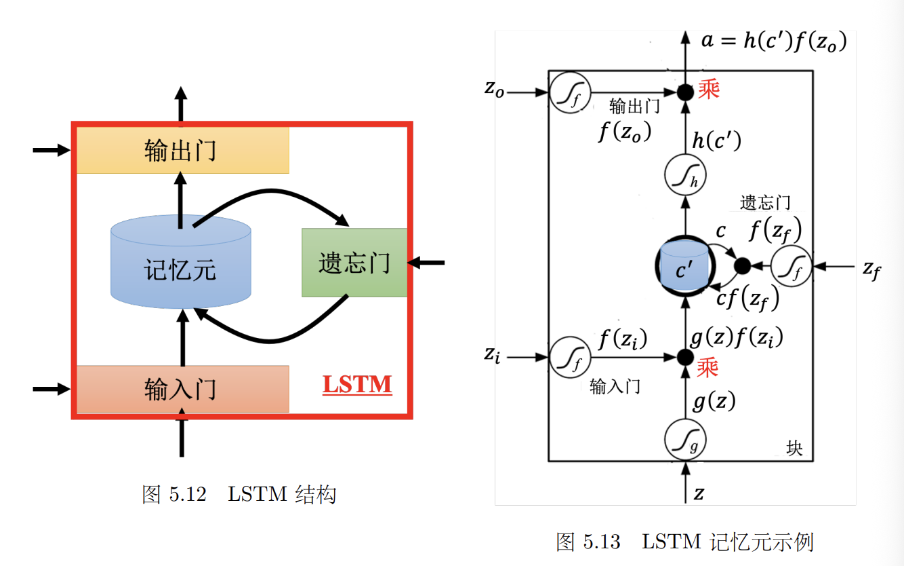
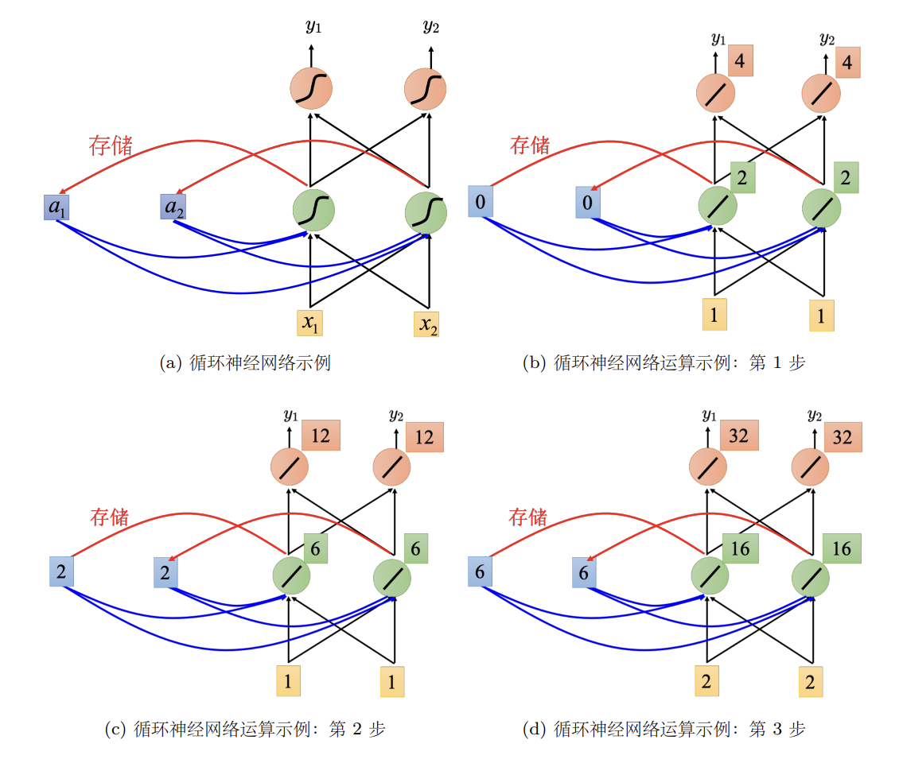
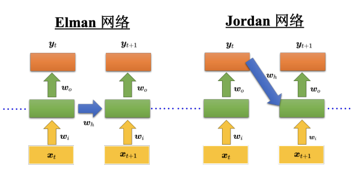
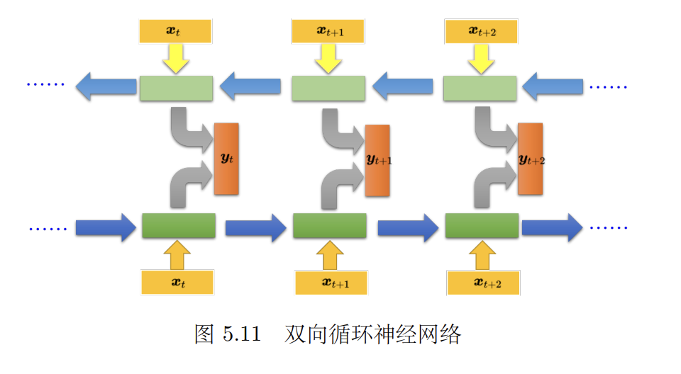

# 第 5 章：循环神经网络

[学习笔记目录](README.md) · [上一章](Chap4%20%E5%8D%B7%E7%A7%AF%E7%A5%9E%E7%BB%8F%E7%BD%91%E7%BB%9C.md) · [下一章](Chap6%20%E8%87%AA%E6%B3%A8%E6%84%8F%E5%8A%9B%E6%9C%BA%E5%88%B6.md)

---



**循环神经网络(Recurrent Neural Network)** 是深度学习领域的一种非常经典的网络结构，在现实生活中有着广泛的应用。
以槽填充为例，系统有一些槽(slot)，系统要自动知道每一个单词是属于哪一个槽。
这个问题可以用一个前馈神经网络解决，输入是一个单词，然后把输入变成一个向量，再丢进神经网络里面。
下面是把单词用向量来表示的方法。

## 5.1 独热编码

假设词典中有个单词：apple, bag, cat, dog, elephant
向量的大小是词典的大小，每一个维度都对应词典的一个单词，对应单词的那个维度为1，其余为0

```math
\begin{aligned} \text{apple} &= [1, 0, 0, 0, 0] \\ \text{bag} &= [0, 1, 0, 0, 0] \\ \text{cat} &= [0, 0, 1, 0, 0] \\ \text{dog} &= [0, 0, 0, 1, 0] \\ \text{elephant} &= [0, 0, 0, 0, 1] \end{aligned}
```

但是这样会有问题，会出现很多没见过的单词。
所以我们需要在独热编码里面多加维度，用一个维度代表other。即如果没有出现在词典中，就被归类为other.

还有一种编码方式，可以把每个单词的子串来表示它的向量，比如单词是apple ,里面出现了子串app, ppl, ple，那么apple对应的向量在app, ppl, ple的维度上就是1，其余都是0，整个空间的维度是 $`26^3`$.

现在我们把单词表示为向量之后，就可以丢进前馈神经网络，输出是要一个概率分布，代表输入单词属于每一个槽的概率。
  比如”我想在8月1号抵达上海“，这里的输出就是判断”上海“属于目的地的概率和属于出发地的概率。

  这就会导致一个问题，如果另一个用户说”我想在6月1号离开上海“，这个时候上海变成了出发地。对于神经网络而言，同样的输入当然只会有一个输出结果，就是概率最高的那个结果。那在这种情况下，如果神经网络有记忆，能记得它在前面看到了“离开“或者”抵达“，那它就能根据上下文产生不同的输出。这样就解决问题了。

## 5.2 什么事RNN?

在RNN里面，每一次隐藏层的神经元输出的时候，都会被存到记忆元中。
下一次输入的时候，神经元不仅会考虑输入的 $`x_1, x_2`$，还会考虑存到记忆元里的值 $`a_1, a_2`$。
  记忆元可以简称为单元，记忆元的值也可以称为**隐状态**。
具体的计算过程如图



这里要注意在做RNN的时候，它会考虑序列的顺序，如果输入序列调换顺序，那么输出就会不同。

然后我们就能给出RNN的由来了
  因为当前时刻的隐状态沿用了上一时刻的计算逻辑，使得隐状态的生成具有循环性，因此这种基于循环计算的隐状态神经网络就被称为循环神经网络。

## 5.3 RNN架构

接着我们上面的例子
  在使用RNN处理槽填充的时候，用户说：“我想在 6 月 1 日抵达上海”，“抵达”就变成了一个向量“丢”到神经网络里面去，神经网络的隐藏层的输出为向量 $`a_1`$，$`a_1`$ 产生“抵达“在每一个槽填充出现的概率为 $`y_1`$，接下来 $`a_1`$会被存到记忆元里面去，“上海”变为输入，这个隐藏层就会同时考虑“上海”和记忆元里面的 $`a_1`$，得到 $`a_2`$，根据 $`a_2`$ 得到 $`y_2`$，$`y_2`$ 是”上海“在每一个槽填充出现的概率。

   注意，这里并没有用三个网络，而是同一个网络三个不同的时间点被使用了3次

这样有了记忆元之后，输入同一个单词，输出就有可能不同，因为同样都是“上海”，一个前面接的是“抵达”，一个是“离开”，二者的向量不一样，隐藏层的输出就不一样，所以存在记忆元里面的值就不一样。这样碰到“上海”的时候，由于存在记忆元里面的值不同，所以隐藏层的输出就会不同，最后的输出就不同！

## 5.4 其他的RNN

RNN的架构当然可以随意设计，前面的例子都是只有一个隐藏层的，当然也可以是深层的。这样，把一个 $`x_t`$ 丢进去之后，它可以通过若干个隐藏层，才得到最后的输出。
每一个隐藏层的输出都会被存在记忆元里面，在下一个时间点，每一个隐藏层就会把钱一个时间点的值读出来，循环往复直到得到输出，这个过程会一直持续下去。

### 5.4.1 Elman 网络 和 Jordan 网络

刚才讲的是简单循环网络（Simple Recurrent Network, SRN），即把隐藏层的值存起来，在下一个时间点在读出来。

还有一种Jordan网络，存的是整个网络的**输出值**，它把输出值在下一个时间点读出来，然后把输出存进记忆元里。
Elman 网络一般就是指的上面的SRN。

做一个比较：
  Elman 网络没有目标，很难控制说它能学到什么隐藏层信息（放到记忆元里），但是 Jordan 网络是有目标，比较很清楚记忆元存储的东西。



### 5.4.2 双向循环神经网络



Bi-RNN 的好处是，神经元输出的时候，他看的范围是比较广的。
在产生 $`y_{t+1}`$ 的时候，网络不只是看过 $`x_1,...,x_{t+1}`$ 的输入，还看了从句末到 $`x_{t+1}`$ 的输入，那么网络就相当于整个输入。这个性能应该会比只看句子的一部分要好。

### 5.4.3 长短期记忆网络LSTM

最常用的记忆元是**长 短期记忆网络（Long Short-Term Memory network，LSTM）**
长时间的短期记忆。
LSTM 有三个门

+ 当外界某个神经元的输出想要被写到记忆元里面的时候，必须通过一个**输入门**。只有输入门打开的时候，才能把值写进记忆元。门的开关是神经网络自己学习的。
+ 输出的地方同样也有一个**输出门**，输出门会决定外界其他的神经元能否从这个记忆元里面把值读出来。输出门打开的时候才可以把值读出来。输出门什么时候打开什么时候关闭，也是网络自己学到的。
+ 还有一个门称为**遗忘门**，决定什么时候记忆元要把过去记得的东西忘掉。这也是网络自己学的

整个LSTM 可以看成是有4个输入，1个输出。
在这4个输入中，一个是想要被存在记忆元的值（但不一定能存进去），还有操控输入门的信号、操控输出门的信号、操控遗忘门的信号，有着四个输入但它只会得到一个输出。

  之前的循环神经网络，它的记忆元在每一个时间点都会被洗掉，只要有新的输入进来，每一个时间点都会把记忆元洗掉， 所以的短期是非常短的，但如果是长时间的短期记忆元，它记得会比较久一点，只要遗忘门不要决定要忘记，它的值就会被存起来。

记忆元对应的计算公式为

```math
\begin{aligned}c'&=g(z)f(z_i)+cf(z_f)\\a&=h(c')f(z_o) \end{aligned}
```

这里，$`z`$ 是要被存到单元的输入，$`z_i`$ 是操控输入门的信号，$`z_f`$ 是操控遗忘门的信号，$`z_o`$ 是操控输出门的信号。这些东西综合起来得到一个输出 $`a`$
$`g(z)`$ 是将 $`z`$ 通过激活函数之后的结果，$`f(z_i)`$ 是 $`z_i`$ 通过另一个激活函数的结果，这里的激活函数一般会选择sigmoid函数，因为值介于0和1之间，就代表了门被打开的程度。
$`c'`$ 是重新存到记忆元里面的值。

我们的计算过程中，$`f(z_i)`$ 能控制$`g(z)`$，因为$`f(z_i)=0\rightarrow f(z_i)g(z)=0, f(z_i)=1\rightarrow f(z_i)g(z)=g(z)`$  这就意味着能决定要不要记忆这个新的输入，
然后 $`f(z_f)`$ 能决定是否把存在记忆元的值 $`c`$ 抹去，也是同样的道理。稍微反直觉的是，遗忘门的“1”，开放，代表记得；“0”，关闭，代表遗忘。

之后得到了 $`c'`$ ，然后再受 $`f(z_o)`$ 操控，$`f(z_o)=1`$ 就表示记忆元里面存在的值能被输出门读出来。
下图很直观地展示了上面的过程。


### 5.4.5 LSTM 运算示例

记忆元的四个输入标量的由来：输入的三维向量乘以线性变换后得到的结果 $`x_1, x_2, x_3`$，去乘以权重再加上一个偏置就得到一个标量。
后面的计算过程没什么好展示的（懒得写了）。

## 5.5 LSTM原理

我们可以把LSTM当成是复杂一点的神经元。
为了简化讨论，假设隐藏层中只有两个神经元，输入为 $`x_1`$ 和 $`x_2`$。
在普通神经网络中，每个神经元接收输入，并通过权重矩阵进行线性变换，最终产生一个输出。而在 LSTM 中，情况有所不同。每个 LSTM 单元需要接收四组不同的输入。
具体来说，输入 $`x_1`$ 和 $`x_2`$ 会分别经过四组不同的权重矩阵变换，得到四组不同的结果，再分别用于控制遗忘门、输入门、输出门和候选记忆状态的计算。第二个 LSTM 单元也采用相同的计算方式。
因此， LSTM 单元需要四组权重参数。
在隐藏单元数量相同、忽略偏置等其他细节的情况下，LSTM 的参数量大约是普通神经网络的四倍。

具体来说：
  假设一整层 LSTM 中包含多个记忆元，每个记忆元都存储着一个值。将所有记忆元中存储的值按照顺序排列，就可以得到一个向量，记为 $`c_{t-1}`$。其中，每个记忆元存储的值对应向量中的一个维度。

  在时刻 $`t`$，网络接收到输入向量 $`x_t`$。首先，将 $`x_t`$ 经过不同的线性变换，得到四个不同的向量，分别记为 $`z`$、$`z_i`$、$`z_f`$ 和 $`z_o`$。这四个向量的维度都与 LSTM 记忆元的数量相同。
  以 $`z`$ 为例，它的第一个维度对应第一个 LSTM 单元，第二个维度对应第二个 LSTM 单元，以此类推。其他三个向量也采用相同的对应方式，分别为每个记忆元提供相应的输入。

  因此，原本需要分别输入每个 LSTM 单元的数值，现在可以通过四个向量统一表示。这样，一整层 LSTM 就可以通过矩阵运算，同时完成所有记忆元的输入计算。

  得到四个输入向量 $`z`$、$`z_i`$、$`z_f`$ 和 $`z_o`$ 后，就可以将它们分别丢进对应的 LSTM 记忆元。
  每个记忆元实际接收到的并不是整个向量，而是一个分量。例如，第一个记忆元接收四个向量的第一个分量，第二个记忆元接收四个向量的第二个分量。不同的记忆元因为输入不同，虽然计算公式一样，但是会得到不同的输出。

   后面就可以按照前面的两个公式计算：首先将 $`z_i`$ 经过激活函数，再与候选记忆状态 $`z`$ 相乘，决定有多少新信息写入记忆元；同时，将 $`z_f`$ 经过激活函数，与上一时刻记忆元中存储的值 $`c_{t-1}`$ 相乘，决定有多少历史信息被保留。然后，将这两部分相加，得到当前时刻新的记忆状态 $`c_t`$。最后，将 $`z_o`$ 经过激活函数得到输出门的值，再与当前记忆状态经过激活函数后的结果相乘，就得到了当前时刻的输出 $`y_t`$。其中，相加得到的结果 $`c_t`$ 就是当前记忆元中存储的新值。

  上述过程会不断重复。在下一个时间点，输入新的向量 $`x_{t+1}`$，通过输入门控制新信息的写入，通过遗忘门控制历史信息的保留，再将两部分相加得到新的记忆状态，最后通过输出门得到新的输出 $`y_{t+1}`$。

  不过，上述结构还不是完整的 LSTM。LSTM 在计算门控信号时，不仅考虑当前时刻的输入 $`x_t`$，还会将上一时刻的输出 $`y_{t}`$ 引入计算。也就是说，在时刻 $`t`$ 的参数不再仅由当前输入 $`x_t`$ 决定，还会受到上一时刻隐藏状态 $`y_{t}`$ 的影响。

引入 Peephole Connection（窥孔连接)。
  Peephole 连接的核心思想是：将记忆元内部存储的值也引入门控计算。这样，在控制 LSTM 各个门时，除了考虑当前输入 $`x_t`$ 和上一时刻的隐藏状态 $`y_{t})`$，还可以直接参考 $`c_{t-1}`$（对于输出门，也可以参考更新后的 $`c_t`$）。

  因此，加入 Peephole 连接后，LSTM 在计算各个门的控制信号时，会综合考虑当前输入、上一时刻的隐藏状态以及记忆元存储的值，再通过不同的线性变换得到相应的控制向量，最终完成记忆状态的更新和输出。
LSTM通常不会只有一层，一般做RNN的时候，其实就是指的用LSTM。

## 5.6 RNN学习方式

要做学习，那就要定义 $`loss function`$ 来评估我们模型的好坏。

以填充槽为例，还是之前的"arrive shanghai on June 1st"，要给橘子一些标签，告诉机器"arrive" 属于other 槽，"shanghai“ 是目的地槽，"on"属于other槽，"June""1st"属于时间槽。"arrive“丢进神经网络，我们得到一个输出 $`y_1`$，然后算它和它的参考向量的交叉熵。这个参考向量的维度是other槽的长度。参考向量对应到other槽的那个维度取为1，其余维度取为0。然后再把"shanghai"丢进去，参考向量对应目的地槽。注意，一定要保证单词序列的顺序！

RNN 的（损失函数输出和参考向量的）交叉熵的和就是要最小化的对象。

在有了 loss function 之后，训练也是用梯度下降做的。
之前我们在梯度下降里用了反向传播（计算梯度$`\frac{\partial L}{\partial w_i}`$）。
我们这里提出反向传播的进阶版本，**随时间反向传播(BPTT)**。BPTT只是要多考虑一个时间上的信息，因为RNN是在时间序列上运作的。

下面是一些会遇到的问题：
  RNN的训练是比较困难的，需要一点运气。
  RNN 的误差表面是很崎岖的，有的时候会遇到悬崖，导致损失暴涨，因为悬崖的梯度很大，而之前的梯度会很小，学习率调的比较大。很大的梯度乘上很大的学习率结果参数就更新很多，整个参数就飞出去了。

  相应的办法是**裁剪**，当梯度大于某一个阈值的时候，不要让它超过那个阈值。

  还会遇到梯度消失的情况。
  考虑一个参数小小的变化，看它对网络输出的变化有多大，就能得到梯度的大小。

  举一个很贱的的例子，只有一个神经元，而且是线性的，输入的权重是 1，输出的权重也是 1， 转移的权重是 $`w`$。也就是说从记忆元接到神经元的输入的权重是 $`w`$。

  假设神经网络的输入是$`[1,0,0,0]^\top`$，$`w`$ 是要学习的参数，我们想知道它的梯度。假设$`w=1`$，在最后一个时间点的时候，是第1000个输出值，对应$`y_{1000}=w^{999}`$，那么$`y_{1000}=1`$，$`w`$ 变化成1.01，$`y_{1000}\approx20000`$，这说明$`w`$ 有一点小小的变化，就能对输出产生非常的影响，这说明 $`w`$ 有很大的梯度。那我们把学习率调小一点就行。但是在0.99的地方，$`w`$ 却又没有梯度了，需要一个很大的学习率。

  但是设置学习率非常麻烦。

  RNN 训练困难的一个核心原因在于：**同一组权重 ($`W`$) 会在不同的时间步中被反复使用。** 因此，权重 ($`W`$) 的微小变化可能会随着时间步的不断传递而累积，最终产生很大的影响；也可能因为反复相乘而使影响逐渐减弱。这会导致梯度消失或梯度爆炸，使得 RNN 的训练变得困难。所以，RNN 训练困难的根本原因并不单纯在于激活函数，而在于它的循环结构：**同一组权重在时间序列中被反复使用，导致梯度在反向传播过程中需要经过多次连乘。**

## 5.7 如何解决RNN梯度消失或者爆炸的问题

广泛应用的技巧就是LSTM。LSTM 可以让误差表面不要那么崎岖。它会把那些平坦的地方拿掉，解决梯度消失的问题，但不会解决梯度爆炸的问题。

为什么呢？
  RNN 跟 LSTM 在面对记忆元的时候，处理的操作不一样。在 RNN 里面，在每一个时间点，神经元的输出都要到记忆元里面去，记忆元里之前的值都是会被覆盖掉。

  但是在 LSTM 里面，它是把原来记忆元里面的值乘上一个值再把输入的值加起来放到单元里面。记忆和输入是按照权重相加的，所以一旦发生影响会永远都存在，除非遗忘门要把记忆元的值洗掉。 所以就不会出现梯度消失的情况。

所以有个传言：在训练 LSTM 的时候，要给遗忘门特别大的偏置，确保遗忘门在多数的情况下都是开启的，只要少数的情况是关闭的。

有另外一个版本用门操控记忆元，叫做 GRU，它只有两个门，更新门（决定保留多少旧记忆，以及引入多少新信息）和重叠门（决定在生成候选记忆时，忽略多少过去的信息，这是机器可以自己决定的），主要的精神就是：**旧的不去，新的不来**。

```math
h_t=z_t\odot h_{t-1} +(1-z_t)\odot\tilde h_t
```

## 5.8 RNN的其他应用

### 5.8.1 多对一序列

输入是一个序列，输出是一个向量。
情感分析是典型的应用。用机器学习的方法学习一个分类器，判断网络上的评价的好坏。

用RNN来做关键术语抽取。
具体过程如下：

1. **输入文档**：将文章中的每个单词通过 Embedding Layer 转换成词向量。
2. **RNN 编码**：RNN 按照单词顺序读取整篇文章，逐步提取上下文信息，得到每个时间步的隐藏状态 $`h_1,h_2,\ldots,h_T`$。
3. **注意力机制**：取最后一个时间步的隐藏状态 $`h_T`$ 作为 Query，与前面各个时间步的隐藏状态进行注意力计算，从而结合整篇文章的信息，判断每个单词的重要程度。
4. **前馈神经网络**：将注意力提取的信息送入前馈神经网络，对每个单词进行预测，判断它是否属于关键术语。
5. **训练模型**：利用人工标注的数据（哪些单词是关键术语），计算预测结果与真实标签之间的损失，通过反向传播更新参数。

### 5.8.2 多对多序列

输入和输出都是一个序列，但是输出的序列比输入的短。
语音识别就是典型的应用。

传统 RNN 语音识别通常将声音信号每隔一小段时间（例如 0.01 秒）转换成一个特征向量，再逐个输入 RNN，由分类器预测每个时间步对应的字符。但是，由于声音帧的数量远多于文字字符的数量，多个连续时间步可能对应同一个字符，因此直接拼接预测结果会出现大量重复字符。例如，可能得到“好好好棒棒棒”，需要通过去重处理得到“好棒”。但简单去重无法区分“好棒”和“好棒棒”。

为了解决这个问题，CTC(**Connectionist Temporal Classification，连接时序分类**) 引入了一个特殊的空白符号（null），允许 RNN 在输出字符之外，也输出表示当前时间步不对应任何字符的空白符号。例如：

- 好、null、null、棒、null → 好棒
- 好、null、null、棒、null、棒 → 好棒棒

这样既能消除连续重复预测带来的问题，又能保留真正需要表达的重复字符。

**CTC 的训练方式**也比较特殊：训练数据只需要提供一段声音特征序列及其对应的完整文字序列，不需要人工标注每个字符具体对应哪几个时间步。CTC 会考虑所有可能的时间对齐路径，并将能够转换成目标文字序列的路径概率加起来，作为该目标序列的概率，再据此计算损失、训练模型。

此外，在英文语音识别中，模型可以直接预测英文字母和 Blank，通过训练学习字符之间的关系，不需要提前告诉模型哪些字母组成一个单词。因此，即使遇到训练集中没有出现过的人名或地名，只要其发音和字母对应关系能够被模型学习到，也有机会正确识别。

### 5.8.3 序列到序列

另一个RNN的应用是**序列到序列(Seq2Seq)学习**，与 CTC 不同，Seq2Seq 不要求输入序列一定比输出序列长，也不要求两者长度相同。

其基本思想是：首先利用 RNN 依次读取整个输入序列，并将输入序列的信息压缩到最后一个时间步的隐藏状态（记忆元）中；然后以这个隐藏状态作为上下文信息，逐步生成输出序列，每次将上一步生成的字符重新作为下一步的输入，直到模型输出特殊的结束符号（EOS），停止生成。由于输入和输出可以具有不同的长度，因此 Seq2Seq 可以应用于机器翻译等任务，例如将英文单词序列转换成中文字符序列。

Seq2Seq 还有一些扩展应用：

1. **跨语言语音翻译**：可以直接输入一种语言的声音信号，输出另一种语言的文字，不必先进行语音识别。例如闽南语转英文，只需要收集闽南语语音及其对应的英文翻译，不需要闽南语的标准文字。
2. **句法解析（Syntactic Parsing）**：将句子的句法结构树转换成序列形式，让模型直接学习从句子到句法树的映射关系，并通过括号等符号表示树的层次结构。
3. **序列到序列自编码器（Seq2Seq Autoencoder）**：将一个文档输入 RNN，编码成一个固定长度的向量，再通过解码器尝试重建原始序列。与词袋模型（BoW）忽略单词顺序不同，这种方法能够保留序列的顺序信息，从而更好地表示文档的语义。例如，"white blood cells destroying an infection" 和 "an infection destroying white blood cells" 虽然包含相同的单词，但语义相反，Seq2Seq 能够利用词序信息区分它们。
