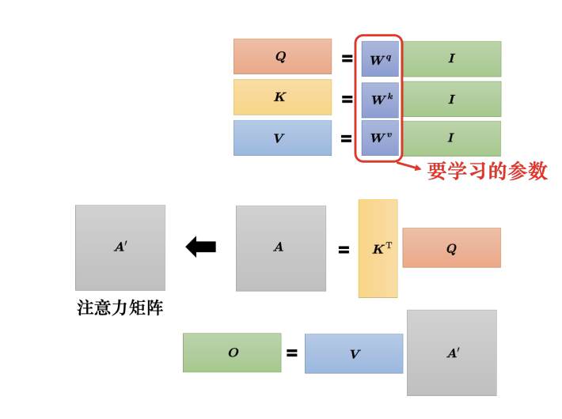
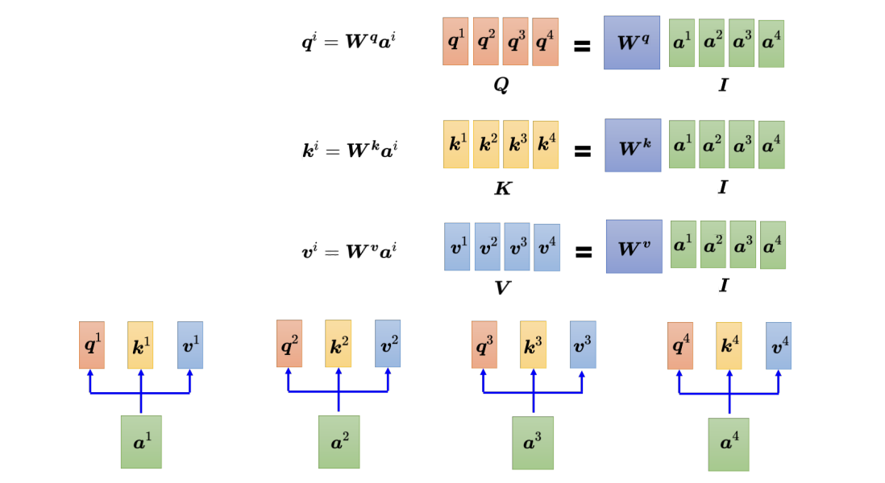
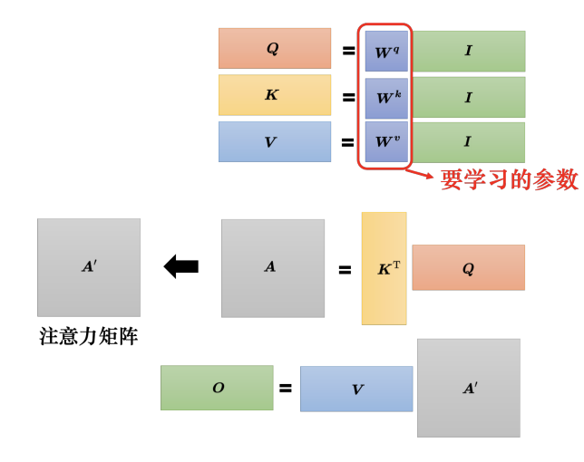
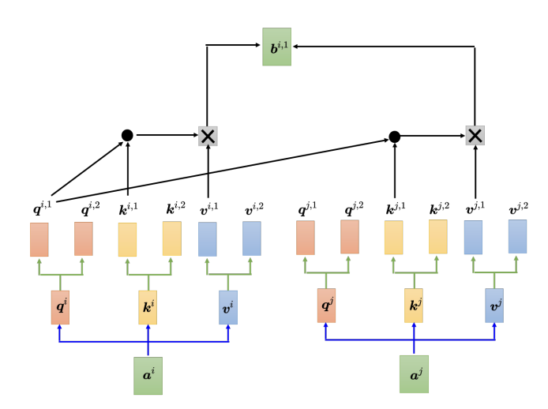

# 第 6 章：自注意力机制

[学习笔记目录](README.md) · [上一章](Chap5%20%E5%BE%AA%E7%8E%AF%E7%A5%9E%E7%BB%8F%E7%BD%91%E7%BB%9C.md) · [下一章](Chap7%20Transformer.md)

---



**自注意力模型（Self-Attention, SA)** 是以另外一个常见的网络架构。

## 6.1 输入是向量序列的情况

**当神经网络的输入不再是固定大小的向量，而是长度不固定的一组向量时，应该如何处理？**
将文字转换为向量我们有两种方法:

1. **独热编码(One-Hot Encoding)**

   假设词汇表只有五个词：

```math
\{\text{apple, bag, cat, dog, elephant}\}
```

  给每个词分配一个五维向量：

```math
\text{apple}=[1,0,0,0,0]\\\text{bag}=[0,1,0,0,0]\\\text{cat}=[0,0,1,0,0]\\\text{dog}=[0,0,0,1,0]\\\text{elephant}=[0,0,0,0,1]
```

  但是它有一个缺陷：**无法表示词语之间的语义关系。**
  例如：

+  cat 和 dog 都是动物，语义比较接近。
-   cat 和 apple 分别是动物和植物，语义差异比较大。

  但是它们的欧式距离完全相同。

  因此，独热编码只是给词汇分配了不同的身份标识，并没有包含语义信息。

2. **词嵌入（Word Embedding）**

   **用一个低维的、可学习的稠密向量表示一个词，使向量能够包含一定的语义信息。**
   例如：

```math
\operatorname{cat}=[0.2,0.8,0.5] \\  \operatorname{dog}=[0.3,0.7,0.6] \\  \operatorname{apple}=[0.9,0.1,0.2] \\
```

  经过训练后，语义相近的词往往会在向量空间中具有较高的相似度。
  这样，一句话就可以表示成一组词向量：

```math
X=(x_1,x_2,\ldots,x_n)
```

  其中每个词对应一个向量，而 $`n`$ 就是句子的长度。

看一个例子：语音识别。
一段声音本质上是一段随时间变化的信号。为了让神经网络处理它，我们通常先将声音切成一帧一帧的小片段。
  我们采用的窗口长度（每次截取声音的范围）为25ms，窗口移动步长（帧数）为10ms。（这两个数值是经过大量实验后形成的经验参数）
  由于每隔 10 ms 就产生一帧，所以：

```math
\frac{1000\text{ ms}}{10\text{ ms}}=100
```

  一秒钟大约有 100 帧，一分钟大约有 6000 帧。因此，一段语音就可以表示成：

```math
X=(x_1,x_2,\ldots,x_{6000})
```

  因此语音识别适合使用序列模型。

再引入一个更广泛的概念：**图**
图由两部分构成：

- 节点（Node）：表示对象。
- 边（Edge）：表示对象之间的连接关系。

  比如社交网络，每个人可以作为一个节点，每个人的年龄、职业等信息可以组成一个特征向量。于是：

```math
G=(V,E)
```

  其中 $`V`$ 是节点集合，$`E`$ 是边的集合。
  每个节点都有自己的特征向量，但节点数量可以不同。

  分子也是类似的：

  - 原子是节点。
  + 化学键是边。
  - 每个原子的元素种类等信息可以用向量表示。

  分子建模通常会用到图神经网络（GNN）。

### 6.1.1 类型1: 输入与输出数量相同

例子：
在文字处理上，假设我们要做的是**词性标注（Part-Of-Speech tagging, POS tagging）**
机器会自动决定每 一个词汇的词性，判断该词是名词还是动词还是形容词等等。
因此每一个输入的词汇都有一个对应的输出的词性。

### 6.1.2 类型2: 输入是一个序列，输出是一个标签

情感分析
判断分子的亲水性

### 6.1.3 类型3: 序列到序列

机器自己决定输出多少个标签
翻译就是序列到序列的任务，因为输入输出是不同的语言， 它们的词汇的数量本来就不会一样多。真正的语音识别输入一句话，输出一段文字，其实也是 一个序列到序列的任务。

## 6.2 自注意力的运作原理

先考虑第1个类型，以序列标注为例。
如果使用全连接网络，碰到这样的句子: "I saw a saw." 这里面前一个saw是动词，后一个是名词，但是全连接网络认为它们是一样的。当然，如果把序列的长度变大，能解决这个问题，但是参数太多了，容易过拟合。

如果想要更好地考虑整个输入序列的信息，就要用自注意力模型。
  自注意力模型会吃下整个序列的数据，输出的向量都是考虑了整个序列才得到的。然后再把整个句子丢进全连接网络，再得到输出。
自注意力模型和全连接网络可以交替使用。

最有名的文章就是

<strong>Attention Is All You Need</strong>

这篇文章里面Google提出了Transformer 网络架构，最重要的模块就是自注意力。

具体的运作过程：
输入是一组向量（可能被处理过），用 $`a`$ 表示，要输出一组向量 $`b`$。
假设有4个输入 $`a^1, a^2, a^3, a^4`$，考虑整个序列之后得到 $`b^1, b^2, b^3, b^4`$

先考虑怎么输出 $`b^1`$.

  Step1 根据 $`a^1`$ 找出输入序列里面和 $`a^1`$ 相关的其他向量。每一个向量跟 $`a^1`$ 的关联的程度可以用 $`\alpha`$ 来表示。如何算出这个数值？$`\rightarrow`$ 需要计算注意力的模块。
  常用的方法是点积。
   左边输入的向量乘上矩阵 $`W^q`$，得到向量 $`q`$，右边输入的向量乘上矩阵 $`W^k`$，得到向量 $`k`$。再计算 $`\boldsymbol{q} \cdot \boldsymbol{k}`$ ，就得到了标量 $`\alpha`$.
  还有一些其他的计算方式，但是最常用的就是**dot**.

  Step2 自注意力模型的QKV模式
  自注意力模型采用查询-键-值(Query-Key-Value)模式。分别计算 $`a^1`$ 与 $`a^2, a^3, a^4`$ 的关联性。
  查询：$`W^q a^1=q^1`$，得到向量 $`q`$ 称为查询。
  键：$`k^2=W^ka^2 ,k^3=W^ka^3, k^4=W^ka^4`$，得到向量 $`k`$ 称为键。
  值：$`q^1\cdot k^2=\alpha_{1,2}`$ ，表示 $`a^1, a^4`$ 的关联性，也被称为注意力的分数，同理得到$`\alpha_{1,3},\alpha_{1,4}`$，实操的时候还会计算和自己的关联性 $`\alpha_{1,1}=q^1\cdot k^1`$
  计算出关联性之后，会去做一个softmax的操作（当然也可以是其他的激活函数），

```math
\alpha'_{1,i}=\frac{exp(\alpha_{1,i})}{\sum_jexp(\alpha_{1,j})}
```

  得到一组 $`\alpha'`$。

  然后根据 $`\alpha'`$ 去抽取序列里面重要的信息。
  先用一个权重矩阵 $`W^v`$ 乘上$`a^1, a^2, a^3, a^4`$，得到 $`v^1, v^2, v^3, v^4`$，然后得到加权和

```math
b^1=\sum_i\alpha'_{1,i}v^i
```

  谁的注意力分数最大，谁的 $`v^i`$ 就会主导抽取出来的结果，也就是 $`b^1`$ 会更加接近 $`v^i`$.
  到这里就完成了计算。

也可以从矩阵乘法的角度来理解注意力机制





自注意力的输入是一组向量，将这排向量拼起来得到矩阵 $`I`$ 作为真正的输入。
然后乘上矩阵：$`W^q, W^k, W^v`$，得到三个矩阵 $`Q, K, V`$。
然后 $`K^\top Q`$ 得到矩阵 $`A`$，处理之后得到注意力矩阵 $`A'`$。
最后 $`VA'`$ 就得到了自注意力层的输出 $`O`$.

实际上要学的参数就只有$`W^q, W^k, W^v`$，需要训练得到。其他都是超参数。

到这里为止，自注意力机制就讲解的差不多了，实际上也不是很复杂～

## 6.3 多头注意力MSA

这是自注意力的进阶版本。
**多头注意力(multi-head self-attention)**
具体有多少头，这是一个超参数。

为什么要用多头呢？
  计算相关性的时候，可以有多个 $`q`$，负责不同种类的相关性，这就是多头。



具体的计算过程见上图，这里 $`q^{i,1}, q^{i,2}`$ 就表示有2个头，$`i`$ 表示对应的输入的序号，1,2就是头的编号。
那么这样也就会有两个 $`k, v`$。
后面计算的时候只要管一个头，$`q^{i,1}`$分别与 $`k^{i,1},k^{j,1}`$ 计算注意力，加权的时候也只要把注意力分数和 $`v^{i,1},v^{j,1}`$ 相乘就行，得到 $`b^{i,1}`$

得到 $`b^{i,1},b^{i,2}`$ ，把这两个接起来，通过一个变换（矩阵）得到 $`b^i`$，送进下一层。
这就是多头自注意力。

## 6.4 位置编码

之前的自注意力层少了位置的信息，因为SA的计算只依赖于矩阵的乘法和加权求和（而且我们在开始会把所有信息输入进去），把词语的顺序全部打乱，不会影响最后的数值。这和RNN非常不同（按照顺序输入）。

因此需要引入**位置编码(positional encoding)** 来解决这个问题。
位置编码会为每个位置设定一个向量，即位置向量，用 $`e^i`$ 表示，把这个 $`e^i`$ 加到 $`a^i`$ 上面就可以了。每一个位置的 $`a`$ 都有一个专属的 $`e`$。

但是问题有来了，这个位置向量是人设定的，如果长度不够怎么办。

在“Attention Is All You Need” 论文中，其位置向量是通过正弦函数和余弦函数所产生的，避免了人为设定向量固定长度的尴尬。

```math
PE_{(pos, 2i)} = \sin\left(\frac{pos}{10000^{\frac{2i}{d_{\text{model}}}}}\right)
```

```math
PE_{(pos, 2i+1)} = \cos\left(\frac{pos}{10000^{\frac{2i}{d_{\text{model}}}}}\right)
```

位置编码还可以使用循环神经网络生成。

## 6.5 截断自注意力

在**自然语言处理(Natural Language Processing，NLP)** 领域，会用到SA.
还有做语音处理的时候。
但输入向量序列非常长的时候，复杂度就会非常大，假设该矩阵的长度为 $`L`$，计算注意力矩阵 $`A'`$ 需要做 $`L \times L`$ 次 的内积，如果 $`L`$ 的值很大，计算量很大，并且需要很大内存。

**截断自注意力（truncated self-attention）** 可以处理向量序列长度过大的问题。截断自 注意力在做自注意力的时候只看一个小的范围就好，不用看整个句子，这个范围是人设定的。这样可以加快计算速度。

## 6.6 自注意力与CNN对比

在图像处理上。
一张图像可以表示为一个 $`H\times W\times 3`$ 的张量，其中每个像素的 RGB 值构成一个三维向量，因此整张图像也可以看作由 $`H\times W`$ 个向量组成的序列，进而使用自注意力处理。

二者的主要区别在于：CNN 中每个神经元只考虑人为设定的局部感受野，而自注意力可以考虑整张图像，并通过学习 Query 和 Key 之间的关联，动态决定哪些像素更值得关注，因此可以将 CNN 理解为受到一定限制的自注意力，**CNN 的函数集是自注意力函数集的一个子集。**

由于自注意力更加灵活，模型表达能力更强，但也需要更多训练数据，否则容易过拟合；CNN 的结构限制较多，具有更强的归纳偏置，在训练数据较少时往往表现更好。随着训练数据量增加，自注意力的优势逐渐显现，甚至可能超过 CNN。因此，二者各有优势，也可以结合使用，例如 Conformer 就同时采用了自注意力和卷积神经网络。

## 6.7 自注意力与RNN对比

二者都可以处理向量序列，但信息处理方式不同。

RNN 通过隐状态（Hidden State）保存历史信息，每次输入一个新向量时，都需要结合前一时刻的隐状态生成新的隐状态，因此普通 RNN 只能利用当前位置及其左侧已经输入的信息；双向 RNN（Bi-RNN）则可以同时利用前后两个方向的信息。

相比之下，自注意力通过 Query 和 Key 计算不同位置之间的关联，使每个输出向量都可以直接获取整个输入序列中的相关信息，即使两个位置相距很远，也能直接建立联系。

此外，RNN 必须按照时间顺序逐步计算，难以并行处理整个序列，而自注意力可以同时计算所有位置的输出，因此具有更高的并行计算效率。

自注意力也可以应用于图结构数据：将节点表示为向量，并利用图中已有的边限制注意力计算范围，只计算相连节点之间的注意力分数，这种方式可以构成图神经网络（GNN）。不过，标准自注意力的主要问题是计算量较大，序列长度为 $`L`$ 时，注意力矩阵的规模为 $`L\times L`$，因此研究者提出了 Linformer、Performer、Reformer 等高效注意力变体，在尽量保留模型性能的同时降低计算开销。
