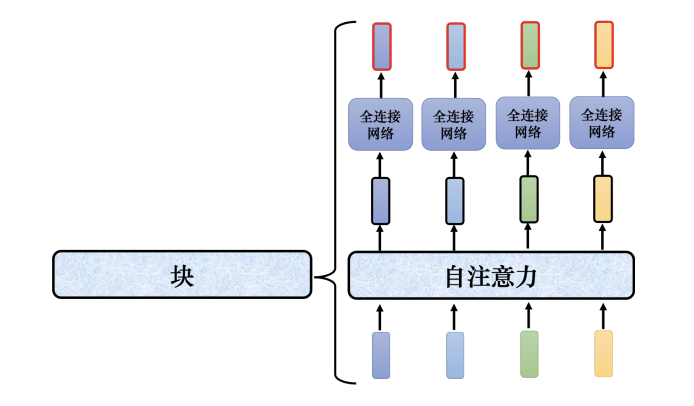
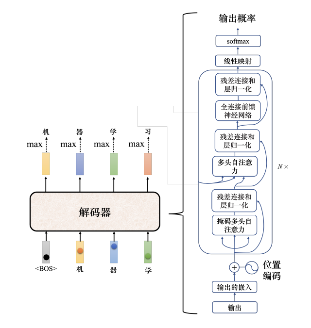

# 第 7 章：Transformer

[学习笔记目录](README.md) · [上一章](Chap6%20%E8%87%AA%E6%B3%A8%E6%84%8F%E5%8A%9B%E6%9C%BA%E5%88%B6.md)

---

Transformer 是一个基于自注意力的序列到序列的模型，能够进行并行计算。（这是RNN的序列到序列无法做到的）
下面从两方面介绍Transformer，

+ Transformer 的结构，即编码器，解码器，编码器-解码器注意力，
+ Transformer 的训练过程以及序列到序列模型的训练技巧

## 7.1 序列到序列模型

### 7.1.1 语音识别、机器翻译与语音翻译

+ 语音识别：输入是声音信号，输出是语音识别的结果，即输入的这段声音信号所对应的文字。由机器自己决定输出的长度。
+ 机器翻译：机器输入一个语言的句子，输出另外一个语言的句子。
+ 语音翻译：对机器说一句话，机器直接把听到的英语的声音信号翻译成中文。（主要用于没有文字的语言，如闽南语）

### 7.1.2 语音合成

输入文字、输出声音信号就是语音合成（Text-To-Speech，TTS）。

### 7.1.3 聊天机器人

文本也很广泛的使用了序列到序列模型。
聊天机器人就是我们对它说一句话，它要给出一个回应。

### 7.1.4 问答任务

序列到序列模型在自然语言处理的领域的应用很广泛，而很多自然语言处理的任务都可以当作是问答（Question Answering, QA）的任务。
就是给机器读一段文字，问机器一个问题，让机器给出一个正确答案。

### 7.1.5 句法分析

给机器一段文字，机器要产生一个句法的分析树，即句法树（syntactic tree）。
在句法分析的任务中，输入是一段文字，输出是一个树状的结构，而一个树状的结构可以看成一个序列，该序列代表了这个树的结构。

### 7.1.6 多标签分类

多分类问题（multi-class classification）是指分类的类别数大于 2。而多标签分类是指同一个东西可以属于多个类。

## 7.2 Tranformer 结构

一般的序列到序列模型会分成编码器和解码器。编码器负责处理输入的序列，再把处理好的结果“丢”给解码器，由解码器决定要输出的序列。

## 7.3 Tranformer 编码器

编码器输入一排向量，输出另外一排向量。
Transformer 的编码器使用的是自注意力，输入一排向量，输出另外一个同样长度的向量。
编码器里面会分成很多的块（block），每一个块都是输入一排向量，输出一排向量给下一个块。
每个块的结构如下。输入一排向量后做自注意力，考虑整个序列的信息，输出另外一排向量。接下来这排向量会“丢”到全连接网络网络里面，输出另外一排向量。



Transformer 里面加入了**残差连接(residual connection)** 的设计。

  Step1: **残差连接** 向量 $`b`$ 输入到自注意力层后得到向量 $`a`$，$`a+b`$ 得到新的输出（这一步就是残差连接，融合了原始的信息和新的信息）

  Step2: 层归一化(Layer Normalization) 对同一个特征，同一个样本（输入向量$`x`$)里面的不同维度计算均值 $`m`$，标准差 $`\sigma`$.

```math
x_i'=\frac{x_i-m}{\sigma}
```

  得到向量 $`x'`$.
  实际 LayerNorm 通常还有两个可学习参数：

```math
y_i=\gamma_i z_i'+\beta_i
```

  其中：  $`\gamma_i`$：缩放参数;  $`\beta_i`$：平移参数。$`y_i`$ 是通过训练自动调整归一化之后的特征。

   Step3: 前馈神经网络  将成归一化之后得到的向量输入进前馈神经网络，

```math
FFN(x)=W_2\cdot \mathrm{ReLU}(W_1x+b_1)+b_2
```

  1. 第一层全连接网络对特征进行线性变换。
  2. 通过激活函数引入非线性。
  3. 第二层全连接网络再次变换特征。

  注意：**自注意力层负责不同位置之间的信息交互，而 FFN 主要负责对每个位置的特征进行进一步加工。**

  Step4: 再做一次残差连接：

```math
u=FFN(z')+z'
```

  Step5: 再做一次层归一化

```math
\boxed{ y=LayerNorm(u) }
```

  就得到了最后的输出。

有一个可以追问的地方：
  *为什么这里用层归一化，而不是批量归一化？*

  它们的差异在于：
  BatchNorm 是针对每个特征维度，跨不同样本计算均值和标准差。
  LayerNorm 则是针对每一个样本，沿着特征维度计算均值和标准差。
  而**Transformer** 的**序列长度不固定**，**经常需要处理不同大小的 Batch**，因此更加适合做层归一化。

## 7.4 Transformer 解码器

解码器负责根据已经理解的信息，一个字一个字地生成识别结果。
比较常见的解码器称为自回归（autoregressive）的解码器。

### 7.4.1 自回归解码器

以语音识别为例

1. Decoder最开始没有任何文字可以作为输入，因此要人为添加一个特殊的**词元(token)**，称为**BOS=Begin Of Sequence**，表示接下来要生成一个新的序列。每一个Token都会有对应的向量表示，可以用独热向量。
2. 然后，把`<BOS>`输入Decoder，Decoder 结合编码器提供的声音信息，计算下一个 Token 的概率分布，选择概率最大的字作为输出。
3. 现在 Decoder 不再只看到 `<BOS>`，而是把刚刚生成的字也作为输入。现在输入由两个

   $`[BOS,first\_output]`$

   然后预测下一个字，输出

4. 不断重复前面的过程。

这就是自回归过程：**当前时刻的输出，会成为下一时刻的输入。**
数学上可以表示为：

```math
P(y_1,y_2,\ldots,y_T|H) = \prod_{t=1}^{T} P(y_t|y_1,\ldots,y_{t-1},H)
```

其中：

- $`H`$：编码器输出。
- $`y_t`$：第 $`t`$ 个生成的 Token。
- $`y_1,\ldots,y_{t-1}`$：之前已经生成的 Token。

我们从这个公式就能看出一个问题，如果前面预测错误，可能影响后面的预测。这就叫**误差传播（Error Propagation）**（错误并不一定会导致后续全部错误，有时模型也能根据编码器提供的声音信息纠正之前的偏差）

Transformer 里面的解码器内部的结构，也有多头注意力、残差连接和层归一化、前馈神经网络。解码器最后再做一个 softmax，使其输出变成 一个概率。



此外，解码器还使用了**掩蔽自注意力(masked self-atttion)**，通过一个**掩码（mask）** 来阻止当前位置关注它右边的未来位置。（防止机器作弊）

具体来说：
  现在假设我们正在计算第二个位置 $`b_2`$。
  首先计算注意力分数：$`q_2k_1^T,\quad q_2k_2^T, \quad q_2k_3^T,\quad q_2k_4^T`$
  但我们不希望它关注 $`a_3,a_4`$，所以在 Softmax 之前加上掩码：

```math
Attention(Q,K,V) = Softmax\left( \frac{QK^T}{\sqrt{d_k}}+M \right)V
```

  其中 $`M`$ 是掩码矩阵。
  例如：

```math
M= \begin{bmatrix} 0&-\infty&-\infty&-\infty\\ 0&0&-\infty&-\infty\\ 0&0&0&-\infty\\ 0&0&0&0 \end{bmatrix}
```

   $`e^{-\infty}=0`$，所以经过 Softmax 以后，被屏蔽位置的注意力权重就变成了 0。
  因此，计算第二个位置时：

```math
b_2=\alpha_{21}v_1+\alpha_{22}v_2
```

  不会再出现 $`v_3,v_4`$，权重为0相当于不存在。

我们最后还需要一个 `<EOS>` 来让模型停下来。

### 7.4.2 非自回归解码器

非自回归模型：一次性准备好所有位置，让模型并行预测。相当于一个并行输出。
例如，我们希望输出：$`\text{机器学习}`$
假设输出长度为 4。
我们一次性输入四个 BOS：

```math
[BOS,BOS,BOS,BOS]
```

经过 Decoder 后，同时得到四个位置的输出。
数学模型为：

```math
P(Y|X)= \prod_{t=1}^{T}P(y_t|X)
```

这就带来一个问题：*怎么确定输出长度？*
因为一次性输出整个序列，事先必须知道准备多少个位置。
有两种方法：

1. 在编码器后面增加一个分类器（Length Predictor）。分类器根据编码器的输出预测目标序列长度。预测概率公式为

   $`P(T=t|X)`$

   其中 $`T`$ 表示输出序列长度。模型选择概率较大的长度作为预测结果。

2. 直接准备一个固定的最大长度

非自回归模型性能往往不如自回归模型，原因：

1. $`P(Y|X)=\prod_t P(y_t|X)`$

   意味着：在给定输入 $`X`$ 后，各个位置的输出被假设为条件独立。但事实上一些输出之间存在很强的关联性，而这里并不能很好地利用。

2. 多个位置可能会出现语意上不一致的预测，即几个位置单独来看可能都有一定概率，但组合起来就不合理。

这实际上是深度学习中一个很典型的权衡：

```math
\boxed{ \text{生成速度}\quad\longleftrightarrow\quad \text{序列依赖建模能力} }
```

非自回归模型牺牲了一部分显式的序列依赖关系，换取并行计算能力。这也是为什么研究者一直在努力提高它的生成质量。

## 7.5 编码器-解码器注意力

编码器和解码器通过编码器-解码器注意力（encoder-decoder attention）传递信息，这是连接编码器和解码器的桥梁。解码器中编码器-解码 器注意力的键和值来自编码器的输出，查询来自解码器中前一个层的输出。

实际运作过程：

  在 Transformer 的 Encoder-Decoder 架构中，编码器首先将输入序列转换为一排向量 $`a_1,a_2,a_3`$，解码器则通过**交叉注意力机制（Cross-Attention）** 从这些向量中提取信息。具体来说，解码器首先输入 `<BOS>`，经过掩蔽自注意力得到一个隐藏状态，并通过线性变换生成查询向量 $`q`$。同时，编码器输出的每个向量分别经过线性变换，生成对应的键$`k_1,k_2,k_3`$ 和值$`v_1,v_2,v_3`$。接着，解码器将查询向量 $`q`$ 与所有键计算注意力分数，再经过 Softmax 得到注意力权重 $`\alpha'_1,\alpha'_2,\alpha'_3`$，最后利用这些权重对值加权求和，得到交叉注意力的输出：

```math
v=\alpha'_1v_1+\alpha'_2v_2+\alpha'_3v_3
```

  这个输出再交给后续的全连接网络等模块进行处理，最终预测下一个 Token。当解码器生成第一个字后，会将  `<BOS>` 和它作为输入，重新计算隐藏状态和查询向量 $`q'`$，再与编码器的 Key 计算注意力分数，并对 Value 进行加权求和，得到新的输出 $`v'`$。因此，**解码器在生成每一个 Token 时，都会根据当前已经生成的内容，重新计算注意力权重，从编码器输出中提取当前最需要的信息**，从而逐步完成整个序列的生成。

## 7.6 Transformer 的训练过程

假设输入的声音信号是“机器学习”，模型需要将其转换成四个中文字：“机”“器”“学”“习”。
编码器首先对声音信号进行处理，解码器则负责逐个预测输出的 Token。

解码器每次输出的是一个概率分布，例如第一次输出一个关于整个词表的概率分布，模型希望其中“机”的概率最大，使这个分布尽可能接近正确答案“机”的独热向量。我们使用交叉熵损失函数衡量预测结果与正确答案之间的差距。

由于每次预测一个中文字都相当于进行一次分类任务，因此整个训练过程实际上包含多次分类：第一次预测“机”，第二次预测“器”，第三次预测“学”，第四次预测“习”，第五次预测 `<EOS>`。训练时，模型会将每个位置的预测结果与对应的正确答案计算交叉熵，再将所有位置的损失加起来（或取平均），作为整个序列的训练损失。

这里有一个重要特点：**训练时，解码器的输入使用的是正确答案，而不是模型自己上一步预测的结果**。具体来说，第一次输入 `<BOS>`，希望模型预测“机”；第二次输入 `<BOS>`、“机”（而不是第一次预测出来的结果），希望模型预测“器”；依此类推，直到输入 `<BOS>`、“机”、“器”、“学”、“习”，希望模型预测 `<EOS>`。这种在训练过程中直接将正确答案提供给解码器作为后续输入的方式，就是所谓的为**教师强制（Teacher Forcing）**。

它能够让模型在训练时始终基于正确的历史序列学习如何预测下一个 Token，而不必受到前面预测错误的干扰。
当然，这个只能在训练的时候用，真实测试的时候没有。

## 7.7 序列到序列模型训练常用技巧

### 7.7.1 复制技巧

copy mechanism.
解码器不一定要完全依靠自身从词表中生成文字，也可以直接从输入序列中复制某些内容作为输出。

例如，在聊天机器人中，用户输入“你好，我是库洛洛”，模型需要回答“库洛洛你好，很高兴认识你”。对于模型而言，“库洛洛”可能是一个非常罕见、甚至从未在训练数据中出现过的词汇，因此仅依靠词表预测可能很难准确生成。而通过复制机制，模型可以直接从用户输入中找到“库洛洛”并复制到输出中。这样，模型需要学习的就不再是如何创造这个陌生词汇，而是判断输入中的哪些内容值得复制，以及应该在输出的什么位置使用它。

在文本摘要任务中，复制机制也非常重要，因为摘要往往会直接保留原文中的关键词、人名、专业术语等内容。如果完全依靠模型从词表中重新生成这些词汇，不仅难度较大，也容易出现遗漏或错误。因此，允许模型从原文中直接复制信息，可以提高输出的准确性和可靠性。早期具有这种从输入中选择并复制内容能力的模型包括**指针网络（Pointer Network）**，后来又发展出了**复制网络（Copy Network）** 等变体。

### 7.7.2 引导注意力

**Guided Attention**
利用任务本身已有的先验知识，对注意力机制施加约束，让模型按照合理的顺序关注输入信息。

例如，在语音合成（TTS）任务中，输入是一段文字，输出是一段语音。假设输入文字是“发财”，模型应该先根据“发”生成对应的语音，再根据“财”生成对应的语音，注意力应该随着生成过程从左向右移动。如果模型训练得不好，就可能出现注意力混乱的情况，例如输入“发财”时只念出“财”，或者生成语音时遗漏某些文字。尤其是对于“发财”这种很短的句子，如果训练数据中类似样本比较少，普通的序列到序列模型可能难以学到稳定的对应关系。

对于语音识别（ASR）和语音合成这类任务，我们通常可以提前知道输入与输出之间应该具有大致的顺序对应关系：输入序列的前面部分应该对应输出序列的前面部分，输入序列的后面部分应该对应输出序列的后面部分。因此，可以在训练过程中加入这种先验约束，要求注意力权重整体上按照从左向右的顺序移动，避免模型随意跳过输入位置或反复关注不合理的位置。这种利用任务先验知识来引导注意力分布的方式，就称为**引导注意力（Guided Attention）**。

### 7.7.3 束搜索

解码器每次都选择当前概率最高的 Token，最终得到的整个句子就一定是最好的吗？答案是不一定。

**贪心搜索**：**每一步只考虑当前最优选择，不考虑这个选择对后续生成的影响。**

但这并不一定最优，关键在于，序列生成是一个具有连续依赖关系的过程。当前选择的 Token 会影响后续 Token 的概率分布。

**局部最优不一定带来全局最优**

**穷举搜索（Exhaustive Search）**
把所有可能的生成路径都尝试一遍，然后选择整体概率最高的路径。
计算量太大

我们采取折中的手段：**束搜索（Beam Search）**
**每一步不只保留概率最高的一个候选，而是保留若干个候选路径，继续向后搜索。**
例如，设置束宽（Beam Width）为 2：

1. 第一步，保留概率最高的两个候选 Token，例如 A 和 B。
2. 第二步，分别从 A 和 B 出发，扩展各自可能的后续 Token。
3. 将所有扩展路径放在一起比较，只保留整体分数最高的两条路径。
4. 重复这个过程，直到生成结束。

**束搜索有时会产生重复句子**，原因在于：束搜索倾向于寻找模型概率最高的序列，但模型的概率分布不一定与人类对语言质量的评价一致。

### 7.7.4 加入噪声

**在解码阶段加入噪声（Noise Injection）**

具体来说，普通的机器学习训练通常会在训练阶段加入噪声或数据扰动，让模型接触更多变化，提高鲁棒性；而测试阶段则希望模型根据学到的规律，稳定地输出结果。然而，语音合成有一个特殊问题：模型按照概率分布选择最可能的输出，不一定能产生最自然的人声。例如，模型可能倾向于选择某种过于确定、单调的发音模式，导致合成语音听起来不够自然，甚至出现机械感。因此，在测试时也加入适当的随机噪声，让解码器的生成过程具有一定随机性，有时反而能产生更自然、更接近真实人类语音的结果。

这里涉及一个重要区别：**概率意义上的最优输出，不一定等于人类感知上最好的输出。** 模型通常通过训练目标优化预测概率或重建误差，但人类评价语音时，还会关注语调、节奏、韵律和自然程度。两者的评价标准并不完全一致。因此，在语音合成或句子生成任务中，适当引入随机性，有时能够避免模型陷入过于僵硬的生成模式。

### 7.7.5 使用强化学习训练

BLEU（Bilingual Evaluation Understudy）最初用于评价机器翻译的质量。它不是逐个 Token 地判断预测是否正确，而是将模型生成的完整句子与人工提供的参考答案进行比较，评价两者在词汇和短语上的匹配程度。

**交叉熵与 BLEU 会产生矛盾**
问题在于：**训练时优化的目标，与最终评价模型好坏的标准并不一致。**

所以，训练时通常使用交叉熵，而在验证集上则可以使用 BLEU 选择最终模型。

但是传统 BLEU 的计算过程包含离散的 Token 匹配、计数和截断等操作，难以给出一个有用的、可微的梯度，告诉模型应该怎样调整参数，不能直接作为普通反向传播训练中的损失函数。

我们引入**强化学习（Reinforcement Learning）**。
把评价指标当成奖励（Reward），通过强化学习的方法优化模型生成序列的策略。
具体过程如下：

1. 解码器根据当前状态生成一个 Token。
2. 将生成的 Token 作为下一步输入，继续生成。
3. 直到生成完整句子。
4. 将完整句子与标准答案比较，计算 BLEU 分数。
5. 将 BLEU 分数作为奖励，利用强化学习更新解码器的参数，使模型以后更倾向于生成高 BLEU 分数的句子。

例如，使用策略梯度方法时，可以通过 REINFORCE 算法更新策略。其基本形式是：

```math
\nabla_\theta J(\theta) = \mathbb{E}\left[ R(Y)\nabla_\theta\log P_\theta(Y|X) \right]
```

其中：

- $`X`$：输入序列。
- $`Y`$：模型生成的完整序列。
- $`R(Y)`$：生成序列得到的奖励，例如 BLEU。
- $`\theta`$：模型参数。

这里利用生成序列的概率分布来估计策略梯度。

### 7.7.6 计划采样

在 Transformer Decoder 的训练过程中，我们使用教师强制，但在测试过程中，模型没有标准答案，只能把自己上一步生成的结果作为下一步的输入。

这就是曝光偏差：**模型训练时只接触正确的历史输入，但测试时却必须面对自己生成的、可能包含错误的历史输入。**

那么既然模型在测试时会看到自己生成的错误，那么能不能在训练时也让它偶尔看到错误？
这就是**计划采样**的想法。
具体而言：

- 有时使用标准答案作为下一步输入。
- 有时使用模型自己生成的 Token 作为下一步输入。
- 让模型逐渐适应可能出现的错误上下文。
